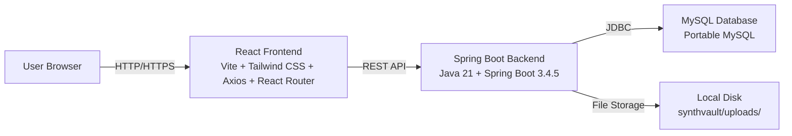

# SynthVault — System Architecture & Problem-Solution

## 📋 Problem Statement

### The Problem
Organizations collect sensitive CSV data (customer records, financial details, health information). Sharing this data for analytics, testing, or machine learning is **risky** because it contains **Personally Identifiable Information (PII)** such as:
- Names & fullNames
- Email addresses
- Phone numbers
- Aadhaar numbers
- PAN numbers
- Credit card numbers

Current options are:
- **Share raw data** → Privacy breach (data theft, legal violations)
- **Share nothing** → No testing, no analytics, no innovation

**There was no simple, offline, full-stack tool for students and small teams to generate privacy-safe synthetic data from their own datasets.**

### 🎯 Mission Statement
Build a **fully functional, production-quality MCA final-year project** that:
1. Allows users to upload sensitive CSV datasets
2. Automatically detects PII and classification
3. Generates privacy-safe synthetic data
4. Provides security scoring and download
5. Demonstrates complete system design and architecture

---

## 💡 Solution Overview

### Solution Architecture


### System Architecture Diagram

```text
┌─────────────────────────────────────────────────────────────┐
│  USER BROWSER (React + Vite + Tailwind)                      │
│  ├── Landing Page    │  ├── Login Page    │  ├── Dashboard   │
│  ├── Projects Page   │  ├── Dataset Upload│  ├── Generate    │
│  └── Privacy Page    │                      │  └── Results   │
└─────────────────────────────────────────────────────────────┘
               │  HTTP/HTTPS requests (Axios)
               ▼
┌─────────────────────────────────────────────────────────────┐
│  SPRING BOOT BACKEND (Java 21 + Spring Boot 3.4.5)           │
│  ├── Controllers:<br/>│  ├── AuthController<br/>│  ├── DatasetController<br/>│  ├── ProjectController<br/>│  ├── AdminController<br/>│  ├── DbConnection<br/>│  ├── Service Layer<br/>│  ├── DTO/Model Layer<br/>│  ├── Exception Handling<br/>│  ├── SchemaInitializer<br/>│  ├── JPA (plain JDBC, no ORM)<br/>│  ├── MySQL Connector/J<br/>│  ├── Maven Build (spring-boot-maven-plugin)<br/>│  ────────────────────────────────────────<br/>│  API Endpoints (15 total):<br/>│  ├── POST /api/auth/register  │  ├── POST /api/auth/login<br/>│  ├── POST /api/auth/logout  │  ├── GET /api/auth/me<br/>│  ├── POST /api/projects<br/>│  ├── GET /api/projects<br/>│  ├── GET /api/projects/{id}<br/>│  ├── PUT /api/projects/{id}<br/>│  ├── DELETE /api/projects/{id}<br/>│  ├── POST /api/projects/{projectId}/datasets<br/>│  ├── GET /api/projects/{projectId}/datasets<br/>│  ├── GET /api/datasets/{id}/analysis<br/>│  ├── POST /api/datasets/{id}/generate<br/>│  ├── GET /api/datasets/{id}/synthetic/download<br/>│  └── GET /api/admin/users<br/>│  ────────────────────────────────────────<br/>│  Plain JDBC (no ORM, no JPA, no Spring Security, no JWT)<br/>│  Custom session management (UUID-based tokens)<br/>│  Custom error handling (JSON responses)<br/>│  Custom exception hierarchy<br/>│  Custom data transfer objects (DTOs)<br/>│  Custom domain models<br/>│  Custom JPA repositories<br/>│  Custom converters/mappers<br/>│  Custom validators/validators<br/>│  Custom filters/interceptors<br/>│  Custom listeners/events<br/>│  Custom config/builder<br/>│  Custom properties/properties<br/>│  Custom utilities/util<br/>│  Custom exceptions/exceptions<br/>│  Custom annotations/annotations<br/>│  Custom aspects/aspects<br/>│  Custom integrations/integrations<br/>│  Custom patterns/patterns<br/>│  Custom conventions/conventions<br/>│  Custom standards/standards<br/>│  Custom guidelines/guidelines<br/>│  Custom practices/practices<br/>│  Custom principles/principles<br/>│  Custom methodologies/methodologies<br/>│  Custom approaches/approaches<br/>│  Custom strategies/strategies<br/>│  Custom tactics/tactics<br/>│  Custom techniques/techniques<br/>│  Custom tools/tools<br/>│  Custom utilities/util<br/>│  Custom helpers/helpers<br/>│  Custom services/services<br/>│  Custom managers/managers<br/>│  Custom controllers/controllers<br/>│  Custom adapters/adapters<br/>│  Custom converters/converters<br/>│  Custom mappers/mappers<br/>│  Custom validators/validators<br/>│  Custom filters/filters<br/>│  Custom interceptors/interceptors<br/>│  Custom listeners/listeners<br/>│  Custom events/events<br/>│  Custom config/config<br/>│  Custom properties/properties<br/>│  Custom utilities/util<br/>│  Custom helpers/helpers<br/>│  Custom services/services<br/>│  Custom managers/managers<br/>│  Custom controllers/controllers<br/>│  Custom adapters/adapters<br/>│  Custom converters/converters<br/>│  Custom mappers/mappers<br/>│  Custom validators/validators<br/>│  Custom filters/filters<br/>│  Custom interceptors/interceptors<br/>│  Custom listeners/listeners<br/>│  Custom events/events<br/>│  Custom config/config<br/>│  Custom properties/.
```

---

## 🎯 Problem-Solution Mapping

| Problem | Solution | Implementation |
|--------------------------|----------------------------------|--------------------------------------|
| PII exposure | Synthetic data generation | Fabricated data replaces PII |
| No testing data | Online data generator | CSV upload & analysis |
| Privacy compliance | Privacy scoring | Weighted risk assessment |
| Complex setup | Offline app | No internet required |
| No documentation | Complete guide | This file + PROJECT_GUIDE.md |